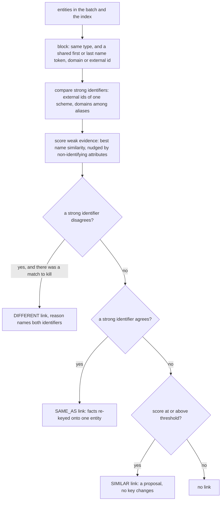

# Resolution & corroboration

After grounding, four stages in `openodke.corroborate` turn candidate facts into
a graph, in this order:

1. **Normalise**, per document: one canonical spelling per value.
2. **Resolve**, over the batch: which entity keys name the same thing.
3. **Corroborate**: merge facts that are one claim, count independent sources,
   and decide contested values.
4. **Score**: one confidence per fact.

Resolution comes first because `Fact.signature` merges on `subject.key`. All
four run on the base install and satisfy their Protocols in `openodke.stages`.

```python
from datetime import UTC, datetime

from openodke import Entity, Evidence, Fact, GroundingVerdict, Ontology, SourceTier
from openodke.corroborate import (
    EvidenceScorer,
    NativeResolver,
    SignatureCorroborator,
    ValueNormalizer,
)
```

## Nothing is overwritten: the reserved `odke.*` keys

Each stage records what it did under a reserved key, outside the signature
([DECISIONS #4](decisions.md#4)). All are `Fact.qualifiers` keys except
`odke.name_key`, on `Entity.attributes`. Each key's constant is its name in
capitals (`SOURCE_FORM`), in `openodke.corroborate`, or `openodke.reextract`.

| Key | Written by | Holds |
|---|---|---|
| `odke.source_form` | `ValueNormalizer` | `{field: (original spelling, ...)}` for each value rewritten; a merge keeps every spelling |
| `odke.name_key` | `ValueNormalizer` | the name's comparison key; the label stays the display form |
| `odke.conflict` | `SignatureCorroborator` | a [contest](#contest)'s `status` (`won`, `lost` or `tied`) and `reason`, plus `to`, `ratio` and `confidence_before` for a loser |
| `odke.score` | `EvidenceScorer` | the [score](#score)'s inputs: `extractor`, `prior_used`, `verdict`, `support`, `conflict` |
| `odke.derived` | the [inverse step](concepts.md#inverse-and-symmetric-partners) | `rule` (`inverse` or `symmetric`) and `of`, the stated fact's signature |
| `odke.widen` | `LLMGrounder(widen=True)` | the [widen-and-retry](grounding.md#widen-and-retry) attempt |
| `odke.check` | the free checks | why they refused: `check` (`predicate`, `domain` or `range`) and `reason` |
| `odke.near_duplicates` | `SignatureCorroborator` | the [near-duplicate](#near-duplicate-sources) document groups |
| `odke.ontology`, `odke.schema_slice` | the gate; `LLMExtractor` | [fingerprints](stores.md#which-ontology-checked-a-fact) of the checking ontology and the model's slice |
| `odke.reextract` | the [re-extract hook](grounding.md#handing-a-gap-back-the-re-extract-hook) | the `window` the fact came from |

Rerunning the corroborator or scorer starts from the extractor's confidence,
read back from these stamps, so a penalty never compounds.

## Normalise

`ValueNormalizer(ontology=None, *, day_first=None, person_types=())` rewrites
`object_value` and every qualifier value into one canonical form, so
"10 December 1815" and "1815-12-10" are one claim, and stamps each entity's
name key. Every rule leaves a value alone when unsure.

| Function | Reads | Canonical form |
|---|---|---|
| `normalize_date(text, *, day_first=None)` | ISO dates and datetimes, `10 December 1815`, `Dec 10, 1815`, `03/04/2020`, `March 2020`, `2020-03` | `1815-12-10`, a month such as `2020-03`, or an ISO datetime; `None` when unsure |
| `normalize_quantity(text)` | `1,234`, `5 km`, `12.5 percent`, `€1.2bn`, `1.5 GiB` | `1234`, `"5000 m"`, `"12.5 %"`, `"1200000000 EUR"`, `"1610612736 B"`; `None` when unsure |
| `name_key(text, *, person=False)` | a name | casefolded, accents and punctuation dropped, `S.A.` → `sa`, `&` → `and`. Organisations lose a leading "the" and trailing legal forms; people are reordered from "Last, First" and lose honorifics and generational suffixes |

- **Dates.** An all-numeric day/month date is read only when one part is above
  12 or both are equal, unless `day_first` settles it. Interval bounds
  (`start_time`, `start`, `end_time`, `end`) are read only as dates.
- **Ranges.** A `string` range is left verbatim apart from whitespace, a `date`
  range read only as a date, a numeric or `quantity` range only as a quantity.
- **Units.** A number with a unit becomes `"<number> <unit>"` in metres,
  kilograms, seconds, bytes or `%`; `KB` is 1,000 bytes and `KiB` 1,024, and a
  year is its own unit. Unit symbols are case-sensitive, scale words apply only
  to money, a leading zero marks an identifier, and numbers are read in English
  notation. Temperature, `pound`, `ton`, months and a decimal comma stay as
  written. Give a predicate with units the range `quantity`; `number` drops the
  unit.
- **Currency** is never converted. A symbol becomes an ISO code only when one
  currency owns it (`€`, `£`, `₹`, `US$`); `$`, `¥` and `Rs` stay as written,
  after the amount.
- **People.** `person_types` names the types whose names are people's.
  Initials are kept.

```python
from openodke.corroborate import name_key, normalize_date, normalize_quantity

assert normalize_date("Dec 10, 1815") == "1815-12-10"
assert normalize_date("03/04/2020") is None
assert normalize_date("03/04/2020", day_first=True) == "2020-04-03"
assert normalize_quantity("5 km") == normalize_quantity("5,000 metres") == "5000 m"
assert normalize_quantity("$1.2bn") == "1200000000 $" and normalize_quantity("5 °C") is None
assert name_key("Acme, Inc.") == name_key("The Acme Corporation") == "acme"
assert name_key("Lovelace, Ada", person=True) == "ada lovelace"

ontology = Ontology.from_dict(
    {
        "types": {"Person": {}, "Company": {}},
        "predicates": {
            "born": {"domain": ["Person"], "range": "date"},
            "headquarters": {"domain": ["Company"]},
        },
    }
)
ada = Entity(key="p:ada", type="Person", label="Ada Lovelace")
born = ValueNormalizer(ontology, person_types=["Person"]).normalize(
    Fact(subject=ada, predicate="born", object_value="10 December 1815")
)
print(born.object_value, born.qualifiers, born.subject.attributes)
# 1815-12-10 {'odke.source_form': {'object_value': ('10 December 1815',)}} {'odke.name_key': 'ada lovelace'}
```

Normalising a normalised fact changes nothing.

## Resolve

`NativeResolver(*, threshold=0.9, nudge_up=0.05, nudge_down=0.15, max_block=100,
lookup=None, judge=None, normalize_batch=False, embed=None, context_floor=0.5,
ontology=None)` is the dependency-free resolver. It proposes links and changes
a key only on proof ([Entities and links](concepts.md#entities-and-links),
[DECISIONS #16](decisions.md#16)).



- **Blocking.** Only entities of one type sharing a name's first or last token,
  a domain or an external id are compared. A name block over `max_block` is
  split by `country`, and skipped if still too large. `candidate_pairs(entities)`
  returns the pairs blocking lets through.
- **Strong identifiers** are `Entity.external_id` and the domains among an
  entity's aliases (`https://www.acme.com/` is `acme.com`); a URL with a path
  is compared as a name. Ids of two schemes (`wikidata:Q95`) neither match nor
  disagree.
- **Weak evidence** is name-key similarity: the better of a `difflib` ratio and
  a token overlap in which an initial counts half, plus `nudge_up` for each
  shared attribute that agrees and minus `nudge_down` for one that does not.
- **The disagreement rule.** A disagreeing strong identifier makes a would-be
  match `DIFFERENT`, with a `reason` naming both, including through a third
  entity.
- **A `SAME_AS`** re-keys facts onto one canonical entity, keeping the other
  keys, labels and aliases as its aliases: the caller's key, then one in the
  index, then one with an `external_id`, then the smallest. A `SIMILAR` changes
  no key.

```python
from openodke import LinkKind

gmbh = Entity(
    key="c:acme-gmbh", type="Company", label="Acme Corporation GmbH", external_id="DE-114322"
)
ltd = Entity(
    key="c:acme-ltd", type="Company", label="Acme Corporation Ltd", external_id="GB-889401"
)
mention = Entity(
    key="c:acme-corporation", type="Company", label="ACME Corporation", external_id="de-114322"
)
normalizer = ValueNormalizer(ontology)
facts = [
    normalizer.normalize(Fact(subject=e, predicate="headquarters", object_value="Munich"))
    for e in (gmbh, ltd, mention)
]

resolved, links = NativeResolver().resolve(facts, {})
for link in links:
    print(link.kind.value, link.source_key, link.target_key, "|", link.reason)
# different c:acme-corporation c:acme-ltd | external_id mismatch: de-114322 vs GB-889401
# different c:acme-gmbh c:acme-ltd | external_id mismatch: DE-114322 vs GB-889401
# same_as c:acme-corporation c:acme-gmbh | external_id match: de-114322

merged = resolved[0].subject
assert resolved[2].subject.key == merged.key == "c:acme-corporation"  # re-keyed on proof
assert merged.aliases == ("c:acme-gmbh", "Acme Corporation GmbH")  # nothing lost
assert merged.resolution.method == "external_id"
assert resolved[1].subject.resolution.linker == "odke.native"  # compared, not merged
assert LinkKind.SIMILAR not in {link.kind for link in links}  # the ids settled every pair
```

Each returned subject's `Entity.resolution` is `external_id` for a merge on a
shared id, otherwise `linker="odke.native"` (`score=1.0` on a shared domain);
one decided upstream keeps its own. The links become `KnowledgeGraph.links`.
[Evaluation](evaluation.md#resolve) scores a resolver against your labels. For
an identifier only your corpus knows, stamp it on as `external_id` first, as
the end-to-end example's `e2e_stages:RegistryResolver` does.

### Resolving against the store

`NativeResolver(lookup=...)` resolves the batch against the store without
loading it ([DECISIONS #31](decisions.md#31)). A `StoreLookup` returns, for each
entity, the stored entities of its type and tenant sharing a block key
(`block_keys(entity)`), judged by the rules above. A proof re-keys the incoming
facts onto the stored entity as stored, never the reverse; the `SAME_AS` keeps
the incoming key. A batch that states the stored key, or a caller's key
(`method="caller"`), keeps its own entity. Anything weaker is a link. Stored
entities are never compared with each other.

```python
from openodke.corroborate import MemoryLookup

acme = Entity(key="c:acme", type="Company", label="Acme Corporation", aliases=("acme.com",))
widgets = Entity(key="c:widgets", type="Company", label="Acme Widgets")
store = MemoryLookup({e.key: e for e in (acme, widgets)})
batch = [
    Entity(key="c:acme-inc", type="Company", label="ACME Inc.", aliases=("https://acme.com/",)),
    Entity(key="c:acme-widget", type="Company", label="Acme Widget"),
]
resolver = NativeResolver(lookup=store)
resolved, links = resolver.resolve(
    [Fact(subject=e, predicate="headquarters", object_value="Leeds") for e in batch], {}
)
for link in links:
    print(link.kind.value, link.source_key, link.target_key, link.score)
# similar c:acme-widget c:widgets 0.9565
# same_as c:acme-inc c:acme 1.0

assert resolved[0].subject == acme  # the stored entity, as stored
assert resolved[1].subject.key == "c:acme-widget"  # a link, not a merge
assert resolver.stats["store"]["rekeyed"] == 1
```

`MemoryLookup(index, *, tenant=None, tenant_property="tenant", limit=100,
embed=None, vector_k=5)` is the store in memory. `Neo4jLookup`, or
`Neo4jSink.lookup(**options)`, reads each batch in one transaction through the
indexes `bootstrap()` creates: the key constraint, `external_id`, and the
`odke_names_<Type>` full-text index (`limit` hits a token). A type without them
is not read, with a warning.

<!-- docs: no-run -->
```python
with Neo4jSink(uri, auth, ontology=ontology) as sink:
    sink.bootstrap(ontology)
    validator = Validator(ontology, lookup=sink.lookup(), sinks=[sink], tenant="acme")
    kg, report = validator.validate(rows, documents)  # report.store: what it found
```

A lookup is scoped to a [tenant](stores.md#tenants); `MemoryLookup` keeps the
entities whose `tenant_property` attribute equals `tenant`. With `embed`, a
function from texts to vectors, the `vector_k` nearest stored labels of the
type are candidates too (in Neo4j, from a `vector_index` you keep).

`bench/store_lookup.py` measures the `SIMILAR` path on Re-DocRED's 500 test
documents, each split into a store and a batch:

| threshold | links | link precision | link recall |
|---|---|---|---|
| 0.8 | 867 | 89.9% | 80.5% |
| 0.9 (default) | 807 | 95.3% | 79.4% |
| 1.0 | 776 | 97.9% | 78.5% |

Across documents: [T-REx](benchmarks.md#corroboration-on-t-rex). In a run
config: [`store_lookup`](run.md#store_lookup).

### The pair judge

Provisional ([Stability](stability.md#provisional)).
`NativeResolver(judge=PairJudge(...))` asks a model about the pairs the rules
leave open: no id or domain settled them, and their name score is from the
judge's `low` (0.7) up to the resolver's `threshold`
([DECISIONS #34](decisions.md#34)).

`PairJudge(roles=None, *, client=None, low=0.7, queue=None, reviewed=None,
store_context=None, max_workers=8, retry=None)`:

- **Both orders.** Each pair is asked as (A, B) and (B, A). "same" counts only
  when both say same, "different" only when both say different; anything else
  is unsure.
- **Links.** "same" is a `SIMILAR` link whose reason names the judge, prompt and
  model, never a merge; "different" a `DIFFERENT` link. Unsure, or a failed
  call, makes none, and the next run asks again.
- **Context.** The prompts `pair@1` and `pair.user@1` ([Prompts](models.md#prompts))
  show each mention's name, type, and sentence with one either side, from
  `judge.documents` (filled by `odke run` and the Validator) or the span's
  quote. A stored entity shows its aliases and `store_context(entity)`. A side
  with no context is not asked.
- **Review.** With `queue=`, each unsure pair is appended once to a JSONL file
  for `odke label make pair`. Labels read back by `odke label read` are
  `reviewed=`: a person decides in the judge's place, and the link's reason
  starts `person:`.
- **The model** is the `ground` role's, retried as the grounder is. A missing
  key raises; a budget stop leaves the pairs it reached `unasked`.

```python
from openodke import Document, Span
from openodke.corroborate import PairJudge
from openodke.llm import RecordedClient

bio = Document(
    id="bio",
    text="Ada Lovelace wrote the first program. She worked with Charles Babbage. "
    "Lovelace died in London in 1852.",
)


def cited(entity, quote):
    start = bio.text.index(quote)
    span = Span(doc_id="bio", start=start, end=start + len(quote))
    return Fact(
        subject=entity, predicate="mentioned", object_value=quote,
        evidence=(Evidence(doc_id="bio", span=span),),
    )  # fmt: skip


ada = Entity(key="p:ada", type="Person", label="Ada Lovelace")
surname = Entity(key="p:lovelace", type="Person", label="Lovelace")
# Recorded answers, by the mention each order names first. Drop `client=` to call a model.
client = RecordedClient(
    [
        {"match": 'Mention A: "Ada', "response": {"because": "one woman", "decision": "same"}},
        {"match": 'Mention A: "Lov', "response": {"because": "her surname", "decision": "same"}},
    ]
)
judge = PairJudge(client=client)
judge.documents[bio.id] = bio
resolver = NativeResolver(judge=judge)
facts = [cited(ada, "Ada Lovelace wrote the first program."), cited(surname, "Lovelace died")]
resolved, links = resolver.resolve(facts, {})
for link in links:
    print(link.kind.value, link.source_key, link.target_key, link.score)
    print(link.reason)
# similar p:ada p:lovelace 0.8
# pair judge (pair@1, anthropic/claude-haiku-4-5-20251001): same in both orders; one woman

assert [f.subject.key for f in resolved] == ["p:ada", "p:lovelace"]  # a link, not a merge
assert resolver.stats["judge"]["calls"] == 2 and resolver.stats["judge"]["swapped"] == 1
```

The first call sent this, and the second the same with the mentions swapped:

```text
Mention A: "Ada Lovelace" (type: Person)
Context A: Ada Lovelace wrote the first program. She worked with Charles Babbage.

Mention B: "Lovelace" (type: Person)
Context B: She worked with Charles Babbage. Lovelace died in London in 1852.
```

`resolver.stats["judge"]` counts the pairs handed in and `asked`, `calls`,
`swapped`, `disagreed`, each decision, `person`, `queued`, `no_context`,
`failed`, `unparseable`, tokens, cost, `cached`, and after a budget stop
`unasked` and `stopped`. `judge.decisions` keeps every `PairDecision`. In a run
config: [`resolver: {use: native, judge: …}`](run.md#the-pair-judge). Where 0.7
comes from: [DECISIONS #34](decisions.md#34).

### Normalising mentions in a batch

Provisional ([Stability](stability.md#provisional)), off by default.
`NativeResolver(normalize_batch=True, embed=None, context_floor=0.5,
ontology=None)` re-keys two mentions the batch introduces onto one entity when
they look alike and nothing keeps them apart ([DECISIONS #43](decisions.md#43)).
A key the store holds is never part of it.

1. **Normalise and block** as resolution does. Given `ontology`, a type's
   aliases are that type, so an `organisation` mention is a `Company`.
2. **Compare.** A pair no id or domain settled, scoring at the `threshold`,
   merges unless both names carry numbers that differ (`Robert II`,
   `Robert III`) or legal forms that differ (`Acme GmbH`, `Acme Ltd`), or,
   given `embed`, the cosine of the mentions' sentences is below
   `context_floor`.
3. **Judge.** In the band below, a [pair judge](#the-pair-judge)'s or a
   person's "same" merges the pair unless the names differ so; "different"
   keeps it apart.
4. **Merge.** One canonical entity per group, chosen as above but preferring an
   entity typed by the ontology's own name to the smallest key, with
   `resolution` at the weakest score it was joined at.

Merges go strongest first. One joining two disagreeing ids, two caller keys or
two mentions kept apart is refused, and a mention alike to two entities kept
apart joins neither. A merge is a `SAME_AS` with a reason starting
`in-batch merge:`; a pair kept apart keeps its `SIMILAR`, with `not merged:`
and why.

```python
sky = Document(
    id="sky",
    text="Mercury is the planet closest to the Sun. Mercury is a metal that stays "
    "liquid at room temperature. Mercury takes 88 days to orbit the Sun.",
)


def mention(key, quote):
    start = sky.text.index(quote)
    span = Span(doc_id="sky", start=start, end=start + len(quote))
    entity = Entity(key=key, type="Thing", label="Mercury")
    return Fact(
        subject=entity, predicate="mentioned", object_value=quote,
        evidence=(Evidence(doc_id="sky", span=span),),
    )  # fmt: skip


def embed(texts):  # stands in for a model: a sentence about orbits, or about metals
    return [[float("planet" in t or "orbit" in t), float("metal" in t)] for t in texts]


facts = [
    mention("t:planet", "Mercury is the planet"),
    mention("t:metal", "Mercury is a metal"),
    mention("t:orbit", "Mercury takes 88 days"),
]
resolver = NativeResolver(normalize_batch=True, embed=embed)
resolver.documents[sky.id] = sky
resolved, links = resolver.resolve(facts, {})
for link in links:
    print(link.kind.value, link.source_key, link.target_key, "|", link.reason)
# similar t:metal t:orbit | not merged: the contexts differ (0.0000 < 0.5)
# similar t:metal t:planet | not merged: the contexts differ (0.0000 < 0.5)
# same_as t:orbit t:planet | in-batch merge: names 1.0, contexts 1.0000

planet = resolved[0].subject
assert [f.subject.key for f in resolved] == ["t:orbit", "t:metal", "t:orbit"]
assert planet.aliases == ("t:planet",) and planet.resolution.score == 1.0
print(resolver.stats["batch"])
# {'alike': 3, 'merged': 1, 'groups': 1, 'mentions': 2, 'numbers': 0, 'forms': 0, 'context': 2, 'ambiguous': 0, 'refused': 0, 'embedded': 3}
```

`stats["batch"]` counts `alike` pairs, those `merged`, the `groups` and
`mentions` made, pairs kept apart by `numbers`, `forms`, `context`, as
`ambiguous` or `refused`, and sentences `embedded`. In a run config:
[`resolver: {use: native, normalize_batch: true}`](run.md#stages); `embed` is
Python only. Why it is off, measured by `bench/batch_normalize.py`:
[DECISIONS #43](decisions.md#43).

## Corroborate

`SignatureCorroborator(ontology=None, *, source=source_of, half_life_days=365.0,
freshness_floor=0.5, intervals=DEFAULT_INTERVALS, documents=None,
near_duplicates=0.9, store=None)` merges claims, then contests values. With
`store`, one `FactLookup` or several, it also
[merges with the store](stores.md#merge-with-the-store) in between.

### Merge by signature

Facts sharing a `signature` are one claim: a denial never merges with its
assertion, nor a p50 value with a p95 one
([DECISIONS #14](decisions.md#14), [#15](decisions.md#15)). The rest is
reconciled:

- **Evidence** is unioned, except from a text that contradicts a claim another
  member supports. That text is no source for the claim: its evidence, sources,
  confidence and valid time are left out, and `odke.conflict` records its
  documents as `contradicted_in` (status `contradicted`, or beside a contest's
  decision). The record outlives later merges, and goes for a document that
  comes back supporting the claim. Delete the supporting text, and the fact is
  retired, not left standing on the one that contradicts it.
- **`support`** counts independent sources: `source_of(evidence)` is the URI's
  host without `www.`, else the document. Pass `source=` to decide otherwise.
- **`supported_by`** names them: the [support list](#support-lists).
- **Qualifiers** agree, or take the interval union for the keys in `intervals`
  (earliest `start_time` and `start`, latest `end_time` and `end`), or the
  best-ranked source's value. Every `odke.source_form` spelling is kept.
- **Valid time** is the earliest `valid_from` and the latest `valid_to`.
- **`verdict`** is the most informative: one supporting span supports the
  claim, else a contradiction outweighs silence.
- **`confidence`** is the members' maximum, and `extractor` joins their names.

#### Near-duplicate sources

Given the texts (`documents=`, by `Document.id`), two documents from different
sources behind one claim count once when the Jaccard similarity of their 5-word
shingles is at least `near_duplicates` (0.9; `None` turns it off). Only
documents behind the same claim are compared. Every evidence is kept,
`odke.near_duplicates` names the group, and the group's tier is its best
member's. `odke run` and the Validator pass the texts they load, and
`stats["near_duplicates"]` counts the pairs compared and found.

#### Support lists

`Fact.supported_by` is a tuple of `Support`, one per independent source, so
`support == len(supported_by)` when it is filled
([DECISIONS #33](decisions.md#33)). The [reconciler](stores.md#reconcile)
reads it when a source changes.

| `Support` field | Holds |
|---|---|
| `source` | the key grouped on: a host, `doc:<id>` for a document with no URI, or a near-duplicate group's least key |
| `doc_ids` | that source's documents the fact cites, sorted |
| `tier` | the best tier among their evidence |
| `retrieved_at` | the newest clock among their evidence |

`support_of(evidence, groups, source)` builds the list, sorted by `source`. A
derived fact shares its parent's ([DECISIONS #28](decisions.md#28)). A claim
with a member that cites nothing, and a fact no corroborator merged, keep the
count and an empty list. Every sink writes it
([provenance](stores.md#provenance-on-every-fact)).

```python
from openodke import Support

two = [
    Fact(
        subject=ada,
        predicate="born",
        object_value="1815-12-10",
        evidence=(Evidence(doc_id=doc, uri=uri, retrieved_at=datetime(2026, 9, day, tzinfo=UTC)),),
    )
    for doc, uri, day in (
        ("bio.md", "https://www.example.org/ada", 1),
        ("register.csv#L2", None, 2),
    )
]
(born,) = SignatureCorroborator().corroborate(two)
for entry in born.supported_by:
    print(entry.source, entry.doc_ids, entry.retrieved_at.date())
# doc:register.csv#L2 ('register.csv#L2',) 2026-09-02
# example.org ('bio.md',) 2026-09-01
assert born.support == len(born.supported_by) == 2
assert isinstance(born.supported_by[0], Support)
```

### Contest

Two claims conflict when they share subject and predicate, the predicate is
`single`, they agree on its [`scope_keys`](ontology.md#cardinality-and-its-scope),
their objects differ, and their valid intervals overlap. A denial and an
assertion of one object conflict on any predicate. Without an ontology, or for
a predicate it does not declare, no value is contested. A value that changed
over time is not a conflict ([DECISIONS #17](decisions.md#17)).

```text
rank      = trust × agreement
trust     = max over its evidence of tier.weight × freshness
freshness = floor + (1 − floor) × 0.5 ^ (age / half_life)
agreement = 1 + ln(1 + Σ_s 1 / (1 + ln n_s))
```

`age` is measured back from the newest evidence in the batch, and `n_s` is how
many claims source `s` backs in the batch, so a source that asserts much has a
smaller vote (Pasternack and Roth's *Average·Log*). With the default floor,
freshness at most halves trust.

The highest rank wins. A loser is kept: its confidence is multiplied by
`rank / winning rank`, and `odke.conflict` says why. Equal ranks are `tied`, at
full confidence.

```python
retrieved = datetime(2026, 9, 1, tzinfo=UTC)
halden = Entity(key="c:halden", type="Company", label="Halden Robotics Ltd")


def cited(doc_id, tier, uri=None):
    return (Evidence(doc_id=doc_id, uri=uri, tier=tier, retrieved_at=retrieved),)


candidates = [
    Fact(
        subject=halden,
        predicate="headquarters",
        object_value="Leeds",
        evidence=cited("register.csv#L2", SourceTier.CURATED),
        confidence=1.0,
    ),
    Fact(
        subject=halden,
        predicate="headquarters",
        object_value="Leeds",
        evidence=cited("factsheet.md", SourceTier.AUTHORITATIVE),
        confidence=1.0,
    ),
    Fact(
        subject=halden,
        predicate="headquarters",
        object_value="Sheffield",
        evidence=cited("halden.md", SourceTier.COMMUNITY, "https://trade.example/halden"),
        confidence=0.5,
        verdict=GroundingVerdict.SUPPORTED,
    ),
]
leeds, sheffield = SignatureCorroborator(ontology).corroborate(candidates)

assert (leeds.support, leeds.qualifiers["odke.conflict"]["status"]) == (2, "won")
lost = sheffield.qualifiers["odke.conflict"]
assert (lost["status"], lost["to"], lost["ratio"]) == ("lost", "'Leeds'", 0.4034)
assert round(sheffield.confidence, 4) == round(0.5 * 0.4034, 4)
print(lost["reason"])
# Kept 'Leeds' over 'Sheffield': 'Leeds' is backed by 2 independent sources (the strongest curated, retrieved 2026-09-01) and 'Sheffield' by 1 independent source (community, retrieved 2026-09-01). Ranked on source trust, freshness, and agreement discounted by how much each source asserts: 2.10 to 0.85.
```

## Score

`EvidenceScorer(*, prior=0.5, verdict_weights=DEFAULT_VERDICT_WEIGHTS,
source=source_of)` sets `Fact.confidence`, monotone and bounded in [0, 1]:

```text
confidence = g(verdict) × (1 − (1 − c) ^ (1 + ln support)) × k
```

- **`c`** is the extractor's confidence, clamped to [0, 1]; exactly 0.0 means it
  reported none, and `prior` stands in.
- **`g`** is the verdict's weight:

    | verdict | `g` |
    |---|---|
    | `supported` | 1.0 |
    | `unchecked` | 0.6 |
    | `not_found` | 0.25 |
    | `contradicted` | 0.05 |

- **`support`** is the corroborator's count of independent sources, or the
  fact's own, whichever is larger; a listed count is never recounted.
- **`k`** is 1, or a contest loser's `ratio`.

The inputs are kept under `odke.score`; scoring twice gives the same number.

```python
from openodke.corroborate import combine

# Worked values at extractor confidence 0.8.
assert round(combine(0.8, 1.0, support=1), 2) == 0.80  # one source, supported
assert round(combine(0.8, 0.6, support=1), 2) == 0.48  # one source, unchecked
assert round(combine(0.8, 0.25, support=1), 2) == 0.20  # one source, not found
assert round(combine(0.8, 1.0, support=3), 2) == 0.97  # three sources, supported
assert round(combine(0.8, 1.0, support=1, conflict=0.35), 2) == 0.28  # lost a contest

scored = EvidenceScorer().score(sheffield)
print(round(scored.confidence, 4), scored.qualifiers["odke.score"])
# 0.2017 {'extractor': 0.5, 'prior_used': False, 'verdict': 1.0, 'support': 1, 'conflict': 0.4034}
```

The score orders facts; it is not a probability until measured. To pick a
threshold, `odke eval score` reports the Brier score, a reliability curve and
ECE against a slice you label ([Evaluation](evaluation.md#score)). Before there
are labels, 0.5 keeps a confident, supported single-source fact and drops an
unchecked single-source one and every contest loser.

## In a pipeline

```python
from openodke import Document, Pipeline


class Replay:
    """Stands in for an extractor: the three candidates above."""

    def extract(self, chunk, ontology):
        return candidates


pipeline = Pipeline(
    ontology,
    Replay(),
    normalizer=ValueNormalizer(ontology),
    resolver=NativeResolver(),
    corroborator=SignatureCorroborator(ontology),
    scorer=EvidenceScorer(),
)
graph = pipeline.run([Document(text="Halden Robotics Ltd has its head office in Leeds.")])
assert [(f.object_value, f.support) for f in graph.facts] == [("Leeds", 2), ("Sheffield", 1)]
```

In an [`odke run`](run.md#stages) config the four are `normalizer: value`,
`resolver: native`, `corroborator: signature` and `scorer: evidence`, with
their options as extra keys. A run's contested values show in its stats as
`corroborator: conflicts (lost 1, won 2)`.
